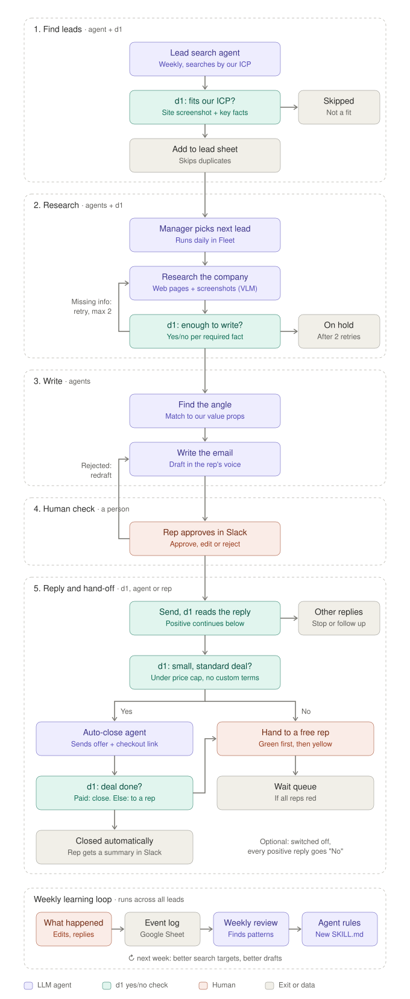

# Architecture



The high-level picture for the pitch is [`system-diagram.svg`](system-diagram.svg); the sketch below maps it to the subagents.

```
Customer brief (offer, ICP, product info)     Lead source (Salesforce in the build, Clay in the pitch)
        │                                               │ get_targets
        ▼                                               ▼
@researcher ──► @positioner ──► @outreach ──► sandbox inbox ──► simulated prospect
 (Kyriakos)      (Gyula)          (JD)                              (Gyula)
                                    │  reply label
                                    ▼
                               @handoff ──► Slack #sales-desk + booked slot + call brief
                                (Slava)
        every stage ──► log_interaction / tag_loss_reason ──► @coach ──► weekly proposals
                                                               (Ayaan)
```

The System of Record (Sales DB, LangSmith, git, and what Slack and Fleet memory are not) and the trace-based hill-climbing loop are in `docs/fleet-prompts-v2.md` §2 and §3.

## Where things live

| Piece | Fleet | Repo |
|---|---|---|
| Manager agent instructions | `AGENTS.md` (system prompt on every run) | `fleet/AGENTS.md` |
| Agent name, description, model, schedules | `config.json` | `fleet/config.json` |
| Tools and which need approval | `tools.json` (`interrupt_config`: true = Ask) | `fleet/tools.json` |
| One subagent per stream | `subagents/<name>/AGENTS.md` + `tools.json` | `fleet/subagents/` |
| Repeated procedures | `skills/<name>/SKILL.md` | `fleet/skills/` |
| Our custom tools | Remote MCP server, referenced by URL | `mcp/` |
| Lead and interaction formats | | `schemas/` |
| Simulated prospects | | `simulator/` |
| Eval datasets | LangSmith datasets | `evals/` |

## Fleet facts that shape the repo (from module 3)

- **Import a ZIP instead of building in chat.** `scripts/build_fleet_zip.sh`, then **+ > Import** in Fleet's sidebar. Import skips schedules, so add them by hand.
- **Tools are stored by MCP server URL.** Changing the URL breaks the agent. Until the server is deployed, every tool points at `https://sales-tools.invalid/mcp`. Once deployed, update every `tools.json` in one PR.
- **No colons in subagent descriptions.** Fleet rewrites the frontmatter and cuts the description at the colon.
- **Rules that must always hold go in `fleet/AGENTS.md`**, not in a skill. Skills are only loaded when the agent decides to.
- **Subagents need their own copy of the rules they follow.** They don't see the main AGENTS.md.
- **Fleet rewrites `config.json` and `tools.json`** when you connect Slack or change approvals. Run `scripts/check_fleet_export.sh` on every export before committing it.
- **Give the agent channel and user IDs.** It can't look up Slack channels by name, and roles should come from Slack user IDs, not from what a message claims.
- **Forbid tool searches and self-edits** in AGENTS.md. Fleet gives every agent a tool search and the ability to edit its own files.
