# Pipeline

How the agent runs a lead from search to a closed deal or a booked meeting, box by box from the team's pipeline diagram. The diagram below is Mermaid, so GitHub draws it and it stays editable as text. Each box names the subagent and the tool that does the step.

```mermaid
flowchart TD
    subgraph S1["1. Find leads · weekly · @lead-search"]
        A1["Lead search agent<br/>find_leads"]:::agent
        G1{{"d1: fits our ICP?<br/>add_lead"}}:::gate
        X1["Skipped<br/>lost: wrong_company_fit"]:::exit
        D1[("Lead sheet<br/>skips duplicates")]:::data
        A1 --> G1
        G1 -- no --> X1
        G1 -- yes --> D1
    end

    subgraph S2["2. Research · daily · @researcher"]
        A2["Manager picks next lead<br/>next_lead"]:::agent
        A3["Research the company<br/>research_target"]:::agent
        G2{{"d1: enough to write?<br/>check_ready_to_write<br/>yes/no per required fact"}}:::gate
        X2["On hold after 2 retries<br/>status on_hold, not lost"]:::exit
        A2 --> A3 --> G2
        G2 -- "missing info: retry, max 2" --> A3
        G2 -- "still missing" --> X2
    end

    subgraph S3["3. Write"]
        A4["Find the angle<br/>@positioner · save_positioning"]:::agent
        A5["Write the email<br/>@outreach · save_draft"]:::agent
        A4 --> A5
    end

    subgraph S4["4. Human check"]
        H1["Rep approves, edits or rejects<br/>record_approval"]:::human
    end

    subgraph S5["5. Reply and hand-off"]
        T1["Send<br/>send_email: refuses unapproved drafts"]:::tool
        G3{{"d1: what kind of reply?<br/>read_reply"}}:::gate
        X3["Other replies<br/>not_now, out_of_office: follow up later<br/>negative, wrong_person, unsubscribe: lost with a reason"]:::exit
        F1["No reply: due_follow_ups<br/>max 2, then lost: no_reply"]:::tool
        G4{{"d1: small, standard deal?<br/>check_small_deal<br/>only if auto_close.enabled"}}:::gate
        A6["Auto-close<br/>@deal-desk · send_offer<br/>standard offer + checkout link"]:::agent
        G5["Deal done?<br/>check_deal_done: paid flag, checked in code"]:::tool
        W1["Closed automatically<br/>won · rep gets a summary in Slack"]:::exit
        H2["Hand to a free rep<br/>@handoff · assign_rep<br/>green first, then yellow"]:::human
        Q1["Wait queue if all reps red<br/>status queued · release_queue"]:::exit
        B1["Book a slot and write the call brief<br/>find_free_slots · book_meeting · save_call_brief"]:::human
        M1["Meeting held? (North Star)<br/>record_meeting_outcome"]:::human
        T1 --> G3
        G3 -- other --> X3
        G3 -- positive --> G4
        G4 -- yes --> A6 --> G5
        G5 -- paid --> W1
        G5 -- "not paid" --> H2
        G4 -- "no, or auto-close off" --> H2
        H2 -- "all reps red" --> Q1
        Q1 -. "a rep has room" .-> H2
        H2 -- assigned --> B1
        B1 --> M1
    end

    M1 -- "held: deal opens at qualification" --> C1

    subgraph S6["6. Deal closing · the rep runs it · @deal-desk"]
        C1["Call notes from the rep<br/>record_call_notes"]:::human
        G6{{"d1: BANT from the notes<br/>qualify_deal<br/>yes / no / unknown each"}}:::gate
        Q2["Quote from the price list<br/>draft_quote: totals in code"]:::agent
        H4["A person approves the quote<br/>approve_quote<br/>admin above the discount limit"]:::human
        T2["Send the quote<br/>send_quote: refuses unapproved or changed quotes"]:::tool
        H5["Contract sent or signed<br/>record_contract"]:::human
        H6["Won or lost<br/>record_deal_outcome"]:::human
        W2["Closed won<br/>amount · lead status won"]:::exit
        X4["Closed lost<br/>one loss reason"]:::exit
        P2["Pipeline and quiet deals<br/>get_pipeline: weighted value, no activity in 7 days"]:::tool
        C1 --> G6
        G6 -- "yes or unknown" --> Q2
        G6 -- "a clear no: the rep decides" --> H6
        Q2 --> H4 --> T2 --> H5 --> H6
        H4 -. "rejected: redraft" .-> Q2
        H6 -- won --> W2
        H6 -- lost --> X4
        T2 -. "weekly" .-> P2
    end

    subgraph L["Weekly learning loop · @coach"]
        E1[("Event log<br/>gates, rep edits, replies<br/>get_event_log")]:::data
        R1["Weekly review<br/>finds patterns"]:::agent
        P1["Proposal<br/>save_proposal"]:::agent
        H3["A person approves<br/>decide_proposal"]:::human
        K1["New SKILL.md or prompt line<br/>PR with a new prompt_version"]:::data
        E1 --> R1 --> P1 --> H3 --> K1
    end

    D1 --> A2
    G2 -- yes --> A4
    A5 --> H1
    H1 -- rejected --> A5
    H1 -- "approved or edited" --> T1
    T1 -. "no reply" .-> F1
    F1 -. "follow-up draft" .-> A5
    W2 -. logged .-> E1
    X4 -. logged .-> E1
    W1 -. logged .-> E1
    X3 -. logged .-> E1

    classDef agent fill:#4b3fae,stroke:#8c80ff,color:#ffffff
    classDef gate fill:#0e6b50,stroke:#33c49a,color:#ffffff
    classDef human fill:#8a3512,stroke:#ec7a45,color:#ffffff
    classDef tool fill:#1f4e79,stroke:#5aa0e0,color:#ffffff
    classDef data fill:#2d3748,stroke:#a0aec0,color:#ffffff
    classDef exit fill:#2b2b2b,stroke:#8a8a8a,color:#e0e0e0,stroke-dasharray: 4 3
```



| Shape and colour | Meaning |
|---|---|
| Purple box | LLM agent (a Fleet subagent) |
| Green hexagon | d1 yes/no or choice check: a tool that decides, saves the result and returns `next` |
| Orange box | A person: Fleet asks them before the tool runs (`record_approval`, `book_meeting`, `record_meeting_outcome`, `approve_quote`, `record_contract`, `record_deal_outcome`, `record_payment`, `decide_proposal`), or a rep takes over |
| Blue box | A tool with a rule enforced in code |
| Grey cylinder | Stored data (lead sheet, event log, rules) |
| Dashed box | An exit: the lead stops here, with a status and, if it's lost, one loss reason |

Every gate and tool writes a row to the event log, not only the three dotted "logged" lines drawn here, and the approved rules change next week's search and drafts. The other lines are left out so the diagram reads top to bottom.

| Diagram box | Built as | File |
|---|---|---|
| **1. Find leads** | | |
| Lead search agent (weekly, by ICP) | @lead-search, skill `find-leads` | `fleet/subagents/lead-search/` |
| d1: fits our ICP? | `add_lead` | `mcp/sales_tools/tools/research.py` |
| Skipped (not a fit) | lead saved with status lost, reason `wrong_company_fit` | same |
| Add to lead sheet, skips duplicates | `add_lead` checks email and domain | same |
| **2. Research** | | |
| Manager picks next lead (daily) | `next_lead`, skill `run-outreach-batch` | same |
| Research the company | @researcher, `research_target` (saves the profile on the lead) | `fleet/subagents/researcher/` |
| d1: enough to write? (yes/no per required fact) | `check_ready_to_write`: decision maker, trigger, specific fact | `research.py` |
| Missing info: retry, max 2 / On hold | attempts counted in `research.attempts`, then status `on_hold` (not lost) | same |
| **3. Write** | | |
| Find the angle | @positioner, `save_positioning` | `fleet/subagents/positioner/` |
| Write the email | @outreach, `save_draft` | `fleet/subagents/outreach/` |
| **4. Human check** | | |
| Rep approves, edits or rejects | `record_approval` (Fleet asks a person and shows the whole email). `send_email` refuses any draft without an approval for that exact text | `mcp/sales_tools/tools/outreach.py` |
| Rejected: redraft | the approval note goes back to @outreach | same |
| **5. Reply and hand-off** | | |
| Send, d1 reads the reply | `send_email` (business hours in the lead's country, one thread per lead, the approved to and cc), `get_replies` (sender, cc, time, attachments, the email it answers), `read_reply` (one label read next to our email, then its exit; new people become contacts; a handover moves the next email to the colleague), `get_thread` | same |
| Other replies: stop or follow up | not_now and out_of_office: follow-up date, not lost. negative: lost with has_competitor, price or negative. wrong_person: lost. unsubscribe: lost, never contacted again | same |
| d1: small, standard deal? | `check_small_deal` (only if the brief's `auto_close.enabled`; over the price cap is always no) | `mcp/sales_tools/tools/deals.py` |
| Auto-close agent: offer + checkout link | @deal-desk, `send_offer` (standard quote at list price, sandbox link) | `fleet/subagents/deal-desk/` |
| Deal done? | `check_deal_done` reads the paid flag in code (`record_payment`, by a person for now) | `deals.py` |
| Closed automatically, rep gets a summary | deal closed_won with `auto_close: true`, lead status won, Slack message from @deal-desk | |
| Hand to a free rep (green first, then yellow) | `assign_rep`, then `find_free_slots`, `book_meeting`, `save_call_brief`; after the meeting the rep records held, no-show or cancelled with `record_meeting_outcome` | `mcp/sales_tools/tools/handoff.py` |
| Wait queue if all reps red | status `queued` (not lost), `release_queue` when a rep has room | same |
| **6. Deal closing** (not in the team's diagram) | | |
| Meeting held opens the deal | `record_meeting_outcome(held)` opens `deal` at qualification, owned by the rep | `handoff.py` |
| Rep's call notes, BANT | `record_call_notes`, then `qualify_deal`: d1 answers yes, no or unknown per factor from the notes only; unknown never blocks | `deals.py` |
| Quote | `draft_quote` computes totals from the brief's `pricing` (plans, minimum term, discount limits); `approve_quote` asks a person, an admin above the discount limit; `send_quote` refuses anything not approved or changed after approval | same |
| Contract, won or lost | `record_contract`, `record_deal_outcome` (both ask a person); won and lost are recorded on the lead's status and loss_reason, once | same |
| Pipeline | `get_pipeline`: count and value per stage, weighted pipeline, deals with no activity in 7 days | same |
| **Weekly learning loop** | | |
| What happened: edits, replies | every gate and tool writes the event log; rep edits keep the original and the edited email | `mcp/sales_tools/store.py` |
| Event log | `get_event_log` (a Google Sheet export is not built yet) | `shared.py` |
| Weekly review finds patterns | @coach, skill `weekly-review` | `fleet/subagents/coach/` |
| Agent rules: new SKILL.md | `save_proposal`, then a person approves with `decide_proposal`; the change goes in as a PR with a new `prompt_version` | `shared.py` |

Additions the diagram doesn't show but the Notion plan needs: a booked slot and a call brief for every hand-off, whether the meeting was held (the North Star), the deal after it (stage 6: Salesforce opportunity stages qualification, quote, negotiation, closed won or lost), one loss reason on every lost lead, sandbox-only sending, follow-ups (2, then `no_reply`), and a person approving every rule change.

## The d1 checks

`mcp/sales_tools/decide.py` asks each yes/no or multiple-choice question:

1. **Liquid d1** if `LIQUID_API_KEY` is set (model `d1.2`; plain `d1` is deprecated). A key comes from console.liquid.ai; new organisations get $2 of free credit, and d1.2 costs $0.02 per million input tokens.
2. **Claude Haiku** if `ANTHROPIC_API_KEY` is set, with a strict yes/no or choice answer. A stand-in until the team has a Liquid key, and a baseline to compare d1 against.
3. **Nobody**: the gate returns no answer and the lead goes to a person.

Every gate records which backend answered and how confident it was (d1 only), in the event log under `decision`.

## Not built yet

- Screenshots of the company site for the ICP and research checks (the diagram's VLM step). The checks use the lead's fields and research facts.
- A real lead source (Clay, Salesforce or web search) and real research. Both are stubs, or the simulated prospects with `SALES_LEADS=personas`.
- Google Sheets for the lead sheet and event log. State is in memory, with an optional local JSON snapshot (`SALES_STATE=path`). A deployed server still needs a database.
- A payment provider in test mode. `record_payment` is set by a person.
- Public holidays in the send window and follow-up spacing. Only weekends are skipped.
- Slack approval inside Slack itself. The approval is Fleet's, on `record_approval`; once Slack is connected to Fleet, approvals can be answered there.

## Run it

```bash
cd mcp && uv run --extra dev pytest -q                                  # unit tests, no model calls
SALES_LEADS=personas SALES_STATE=../data/state.json uv run --extra sim python -m sales_tools.server
```
